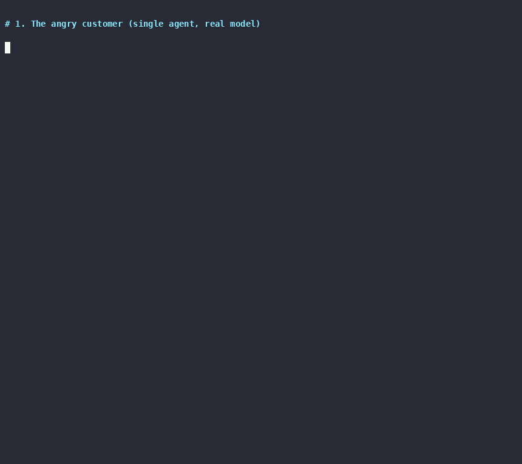
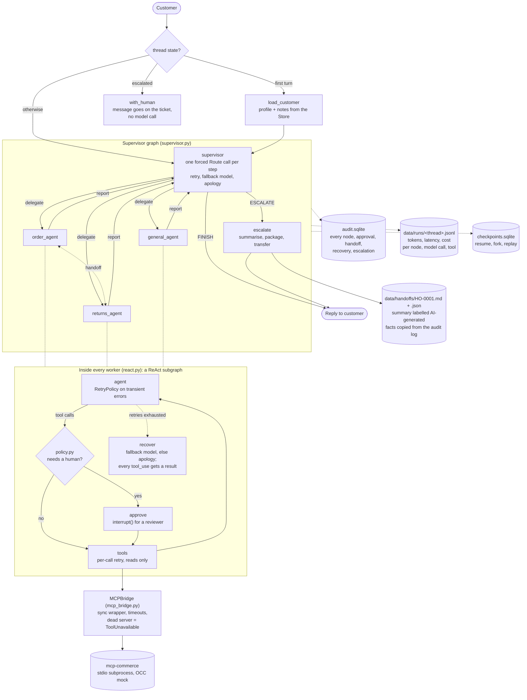

# commerce-support-agent

A customer-support agent for a commerce store, built in LangGraph over the
[`mcp-commerce`](../mcp-commerce) MCP server (Month 2). A supervisor routes
each message to order, returns and general workers; refunds over ₹5,000 stop
for a human; hard cases are handed to a person with a briefing document; and
every step is audited, traced and recoverable.

The question the project answers: **when is multi-agent worth it?** For this
agent, it isn't, and the section below shows how that was worked out.

## Demo



A real run against Claude (single agent, `claude-opus-5`): the customer is
angry about a late order, the agent finds it, checks eligibility, and the
₹7,999 refund stops for a human under the ₹5,000 rule. Then the audit trail,
and the chaos tests that kill the MCP server. Recorded 2026-10-28 with
`asciinema` ([`docs/demo.cast`](docs/demo.cast)); how: [`docs/DEMO_SCRIPT.md`](docs/DEMO_SCRIPT.md).

## Architecture



Source: [`docs/architecture.mmd`](docs/architecture.mmd). Where things are:

| Concern | Code | What it does |
|---|---|---|
| The agent loop | `react.py` | ReAct as an explicit graph: `agent`, `approve`, `tools`, `give_up` |
| Multi-agent | `supervisor.py`, `case.py` | supervisor, workers, handoffs, shared case file |
| Human in the loop | `policy.py`, `hitl.py` | approval rules as code, per call and per argument; `interrupt()` pause and resume |
| Memory | `persistence.py`, `memory.py` | SQLite checkpoints (a conversation survives a restart), long-term customer notes in a Store |
| Tools | `mcp_bridge.py` | the async MCP client behind a sync tool interface, on its own event-loop thread |
| Escalation | `escalation.py` | summarise, package, transfer; the bot stops answering |
| Audit | `audit.py` | append-only: who allowed what, under which rule |
| Resilience | `resilience.py` | retries, fallback model, recovery path (below) |
| Tracing | `tracing.py` | tokens, latency and cost per conversation (below) |

## Run it

```bash
uv sync
echo 'ANTHROPIC_API_KEY=sk-ant-...' > .env
uv run python scripts/chat.py --supervisor --customer C-100 --thread demo
uv run python scripts/chat.py --mcp --thread wismo   # against the mcp-commerce server
uv run python scripts/audit.py --thread demo         # who did what, and who approved it
uv run pytest                                         # offline: no API calls, 200+ tests
```

The demo flow is in [`docs/DEMO_SCRIPT.md`](docs/DEMO_SCRIPT.md).

## What was verified, and how

- **Live against Claude:** the single agent, including the end-to-end scenario
  (`failures.md`: six failures found and fixed, the last one, F6, confirmed
  on 2026-10-28), and two supervisor runs on 2026-10-28 that reached the
  approval gate and found three more problems (F7-F9, not all fixed).
- **Offline only:** the rest: shared state, escalation
  transfer, handoff limits, resilience paths, and the supervisor's
  recovery. The scripted-model tests exercise the graph, policy, audit log
  and recovery for real; what they can't tell you is how Claude behaves
  inside them, which is what F8 is about. Still owed live: the cost
  comparison between designs under controlled turns (the multi-agent
  numbers below are counted from the graph, plus the two indicative runs in
  `failures.md` F9).

## When something breaks

| Failure | What happens | Where |
|---|---|---|
| Model call fails (connection, 429, 5xx) | retried 3x with backoff by the node's `RetryPolicy`; then a fallback model if configured; then a plain apology | `react.py`, `supervisor.py` |
| A read tool can't be reached | retried once, per call | `react.py` |
| **A write tool can't be reached** | **never retried**: no answer doesn't mean it didn't happen. The model is told the system isn't responding, and not to guess | `resilience.py` |
| MCP server killed or hung | `ToolUnavailable`, immediately; the conversation carries on | `mcp_bridge.py`, `tests/test_chaos.py` |
| A node crashes unexpectedly | `error_handler` ends the run with an apology and gives every pending `tool_use` a result, so the next API call isn't a 400 and the thread isn't bricked | `react.py` |
| The summary model is down during an escalation | the handover goes ahead, with the facts and a note that the AI summary is missing | `supervisor.py` |

Why the retries sit where they do: a retry policy on the `tools` node would
re-run the whole batch of calls, repeating a write that already succeeded.
So tool retries are per call, inside the node, and only for tools marked
read-only (from the MCP server's own `readOnlyHint`). Timeouts are per call
too: LangGraph's node `timeout` only works on async nodes, and this graph
is sync.

## Seeing what a conversation cost

`scripts/chat.py` writes every node, model call and tool call to
`data/runs/<thread>.jsonl` and prints a summary on exit:

```
thread e2e
  model   5 calls (0 failed)  17329 in / 1160 out tokens  $0.1156  21.1s
  tools   3 calls (0 failed)  0.00s
  node    agent                    5 runs   21.11s
  node    tools                    3 runs    0.00s
  node    approve                  2 runs    0.00s
  node    load_customer            1 runs    0.00s
```

That is the live end-to-end scenario (`scripts/e2e.py --reject`, 2026-10-28).
It's a callback handler passed through the graph config, so workers inside
the supervisor are traced with no change to any node. Cached tokens are
priced at the cache rate, and a model without a price is counted as
"unpriced" instead of guessed.

## Single agent, supervisor, handoffs, shared state: when is multi-agent worth it?

The repo has all four designs, built over the same tools, policy and audit
log:

| Design | Code | Who decides the next step | What each agent sees |
|---|---|---|---|
| Single agent, all tools | `react.build_explicit` | one ReAct loop | everything |
| Supervisor + isolated workers | `supervisor.build_supervisor()` | supervisor, after every report | a worker sees only its brief |
| ... + handoffs | the same, `transfer_to_*` tools | a worker can pass the case on directly | the receiver sees the sender's note |
| ... + shared state | `build_supervisor(shared=True)` | supervisor | conversation + shared case file |

### What each costs, on the end-to-end scenario

The angry customer, late order 1048, refund over the approval threshold, two
customer turns. Model calls per design:

| Design | Model calls | How the number was obtained |
|---|---|---|
| Single agent | **5** | measured: live run 2 of the end-to-end scenario (`failures.md`) |
| Supervisor | ~11 | counted from the graph: 5 supervisor calls (route, route, finish; route, finish) + 6 worker calls |
| Supervisor + handoff | ~10 | the handoff saves the supervisor call between order_agent and returns_agent |
| Shared state | ~11, with longer prompts | as the supervisor, and every worker prompt also carries the conversation and case file |

The multi-agent numbers are worked out, not measured: the API credit ran
out before they could be run live. The ratio is the point, and it follows
from the structure: every hop through a supervisor is an extra model call,
and every worker re-establishes context the single agent already had. The
same goes for latency, since the calls are sequential.

### What multi-agent buys you, and whether it applies here

| Claimed benefit | Real? | In this repo |
|---|---|---|
| Smaller prompts and tool lists per agent | Yes, once a single agent has too many tools to choose from reliably | **No.** The single agent has 7 tools; that's well within what one prompt handles |
| Hard permission boundaries | Weaker than it looks | **No.** `policy.py` gates actions per call, inside every design. Moving a tool to another agent isn't a security boundary; the policy is |
| A different model per role (cheap router, strong worker) | Yes | **Possible**, not done: routing is the obvious Haiku candidate, but not measured |
| Parallel work | Yes, for independent lookups | **Not used.** The map-reduce in `wismo.py` got parallelism inside one graph without extra agents |
| Separate ownership: teams, prompts, evals per domain | Yes, organisationally | **No.** One developer, one domain |

### The failure modes it adds

- **Isolated workers lose context.** Anything the supervisor leaves out of a
  brief, the worker doesn't know. "The customer has already confirmed" is
  the classic miss, and it costs a whole extra turn.
- **Handoffs lose context in the note,** for the same reason, and can
  bounce back and forth. Hence `max_handoffs`, and handoffs counting as
  delegations.
- **Shared state brings back the single agent's context size,** spread over
  more calls, and adds write conflicts. Those need rules: `case.py` uses
  field ownership, history on overwrite, append-only notes, and a reducer
  so the rules hold for parallel writers.
- **Debugging is harder.** A wrong answer can come from the routing, a
  brief, a worker, or the summary. The audit log names each worker
  (`returns_agent/tools`) and records every routing decision and handoff;
  without that, multi-agent runs are close to impossible to debug.

### The honest answer

For this agent, a single ReAct loop with the policy layer is the better
design: about half the model calls, one prompt to debug, and nothing the
multi-agent versions do that it can't. Multi-agent is worth it when at
least one of these holds:

1. **Too many tools for one agent.** Tool choice degrades long before the
   context window fills. If evals show wrong-tool calls rising as tools are
   added, split by domain.
2. **The work really is parallel and independent,** like research across
   sources. Then the extra calls run at the same time instead of in a row.
3. **The roles need different models or different owners.** A cheap
   router in front of expensive specialists, or one team per domain
   shipping its own prompts and evals.

The cheapest step that's still worth having isn't multi-agent at all: a
**router** (one cheap classification call, or the keyword
`classify` in `graph.py`) in front of narrower single agents. If the traces show one hop
per turn, that's what the supervisor was anyway.

## Escalation, and why it looks like contact-centre integration

`escalation.py` hands a case to a person in three steps: **summarise** the
conversation (one model call), **package** a handoff document, and
**transfer** it: queue it, write it out as `data/handoffs/<ticket>.md` and
`.json`, and take the bot out of the thread. That's the shape of a
bot-to-agent transfer in a contact-centre platform, and building it by hand
makes the reasons for that shape obvious:

- **The document is an integration contract.** The `.json` is what a
  real transfer API would receive: a ticket or case with routing
  attributes (queue, priority), the customer and order ids, and the
  transcript attached. The `.md` is the agent's screen pop. In a commerce
  stack the ticket lives in the service system, not the shop, and the
  `customer_id` and order numbers are the keys that link it back to the
  commerce data. Without those keys, the human's screen pop can't show the
  order.
- **Summary and record are kept apart on purpose.** Agents on the receiving
  end stop trusting AI summaries the first time one is wrong, and then they
  re-ask the customer, which is the thing a handover exists to prevent. So
  the summary is labelled as generated, and the facts under it (approvals
  with reviewer and rule, handoffs, the transcript) are copied from the
  audit log verbatim. Building it showed why: the first version reported a
  *rejected* refund as `create_return ran (error)`, which a person would
  read as a system failure.
- **One owner per conversation.** Once transferred, the bot stops answering:
  new messages go onto the ticket (`with_human`) without a model call. A
  contact centre does the same, for the same reason: two parties answering
  one customer, neither aware of what the other said.
- **This is a cold transfer:** the case goes to a queue, and whoever picks
  it up reads the document. A warm transfer, where the bot introduces the
  human in the live chat, needs agent-availability data this stub doesn't
  have. That's also why the reply promises no channel and no time.
- **Missing before this could face customers:** checking agent availability
  and business hours before transferring, carrying over the customer's
  verified identity, redacting personal and payment data from the
  transcript, a path back from human to bot, and closing the ticket.
